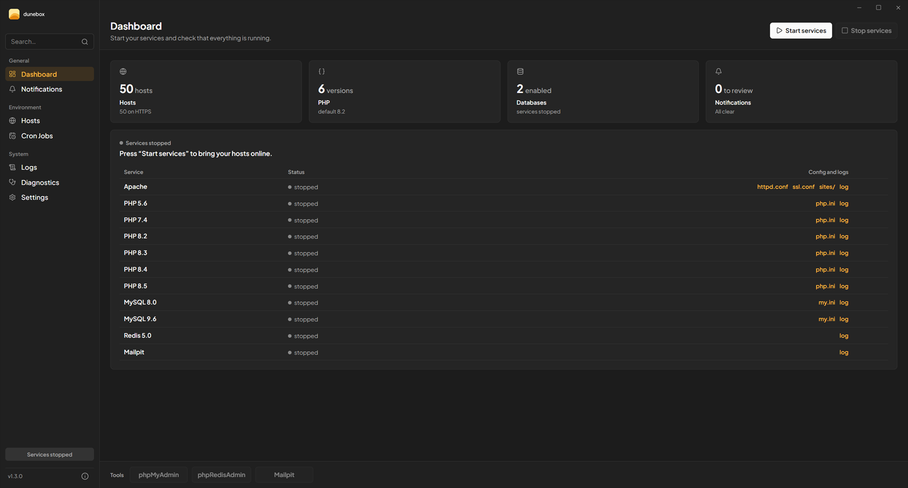

  

  <picture>
    <source media="(prefers-color-scheme: dark)" srcset="dunebox-wordmark.svg">
    
  </picture>

<strong>The complete PHP development environment for Windows.</strong>

Download a zip, extract it wherever you want, open `dunebox.exe`. On first launch a short wizard lets you choose what to install, then Dunebox downloads and configures everything by itself: web server, several PHP versions side by side, databases, mail, tools. No installer, no Windows service — when you remove it, just delete the folder.

  <picture>
    
  </picture>

<strong>Freeware</strong> — free to use, built for <strong>Laravel and PHP</strong> developers on Windows.

  <a href="../../releases/latest"><strong>⬇ Download</strong></a> ·
  <a href="https://dunebox.enesi.it/docs.html" target="_blank"><strong>📖 Documentation</strong></a> ·
  <a href="https://dunebox.enesi.it" target="_blank"><strong>🌐 Website</strong></a>

---

## 📥 Get started

1. Download **`dunebox-vX.Y.Z.zip`** from the [latest release](../../releases/latest).
2. Extract it wherever you like (we recommend `C:\dunebox`).
3. Open **`dunebox.exe`** and follow the short setup wizard.

Requirements: Windows 10/11 (64-bit). Updates install themselves from the app.

Features, supported versions, guides and the CLI reference are all in the **[documentation](https://dunebox.enesi.it/docs.html)**.

## ⭐ Like it?

If Dunebox is useful to you, leave a **★ Star** and click **👁 Watch** at the top of this page to follow new releases. It helps a lot.

## License

Dunebox is **freeware**: free to use under its [End User License Agreement](LICENSE). The third-party components it installs keep their own (open source / freeware) licenses.